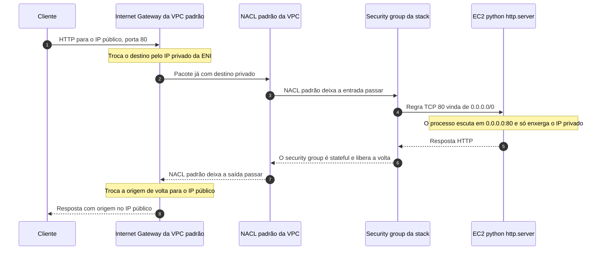

# Como uma requisição chega na EC2

Uma chamada HTTP para o IP público desta instância entra pelo Internet Gateway da VPC padrão. Esse gateway troca o destino pelo IP privado da instância. Em seguida o pacote passa pela NACL da subnet e pelo security group, e o `python3 -m http.server` na porta 80 responde. A volta faz o caminho inverso, e o gateway recoloca o IP público como origem.

O template `ec2.cfn.yml` não cria VPC, subnet nem NACL. A instância cai na VPC padrão da região do deploy, numa das subnets padrão, e ganha um IPv4 público porque essa subnet atribui IP público na criação. SSH na porta 22 segue os mesmos saltos, usando a outra regra do security group.

A VPC é a rede inteira, `172.31.0.0/16`. Uma subnet é um pedaço dessa rede, preso a uma zona de disponibilidade. Na VPC padrão existe uma subnet por zona: em geral faixas `/20`, como `172.31.0.0/20` e `172.31.16.0/20`. A região tem várias zonas, então a VPC padrão tem várias subnets. A EC2 deste script usa só uma delas. A AWS escolhe qual, porque o template não informa `SubnetId`.

## O que já existe e o que a stack cria

| Peça | Quantas existem neste caminho | O que faz com o pacote |
| --- | --- | --- |
| VPC padrão | Uma por região | Rede `172.31.0.0/16` onde a instância nasce |
| Internet Gateway | Um por VPC padrão, portanto um por região | Traduz IP público e IP privado |
| Route table principal | Uma por VPC padrão | Manda `0.0.0.0/0` para esse Internet Gateway |
| NACL padrão | Uma por VPC, ligada a todas as subnets dela | Filtra na borda da subnet. A padrão libera tudo |
| Subnet padrão | Uma por zona de disponibilidade | Entrega o IP privado e o IP público |
| Security group da stack | Um, criado pelo CloudFormation | Libera TCP 80 e TCP 22 vindos de `0.0.0.0/0` |
| IP público | Um por instância | Endereço que o cliente consulta |

Todas as EC2 lançadas na VPC padrão da mesma região compartilham o mesmo Internet Gateway, a mesma route table e a mesma NACL padrão. Cada instância tem o próprio IP público e o próprio IP privado. Outra região tem outra VPC padrão e, com ela, outro Internet Gateway.

## Internet Gateway

O gateway padrão já vem anexado à VPC padrão. Criar a EC2 reutiliza esse gateway. A consulta continua sendo para a instância: o cliente fala com o IP público dela, e o gateway só faz a tradução de um para um.

- Na ida, o destino público vira o IP privado da placa de rede.
- Na volta, a origem privada vira o IP público.

O sistema operacional só mostra o IP privado. O IP público muda se a instância for parada e iniciada de novo.

## NACL

NACL é a lista de controle de acesso da subnet. Ela olha o pacote na entrada e de novo na saída. As regras são numeradas e a primeira que combinar decide. A NACL padrão tem uma regra que permite todo o tráfego e, no fim, uma regra que nega o resto. Como a permissão vem antes, o efeito prático é deixar passar.

Ela é stateless: a resposta precisa de uma regra de saída, além da regra de entrada. Na NACL padrão as duas existem, as duas permitem tudo.

Neste script existe uma NACL só, a padrão da VPC. Essa mesma lista está associada a todas as subnets da VPC padrão. "Associada a cada subnet" significa que cada subnet aponta para essa lista única, não que cada subnet tenha a sua.

A instância fica em uma subnet, e as outras subnets da mesma VPC continuam de pé, com a mesma NACL, o mesmo Internet Gateway e a mesma route table. Uma NACL criada depois vale só para as subnets que passarem a apontar para ela.

## Security group

O security group deste desenho é o `InstanceSecurityGroup` do template. Ele fica na placa de rede da instância e é stateful: se a entrada na porta 80 foi aceita, a resposta volta sem uma regra extra de saída. A VPC também tem um security group padrão, e esta instância usa o grupo criado pela stack.

A NACL e o security group filtram em camadas. Os dois precisam deixar o pacote passar. Aqui a NACL padrão libera tudo, e o security group escolhe as portas 80 e 22.
